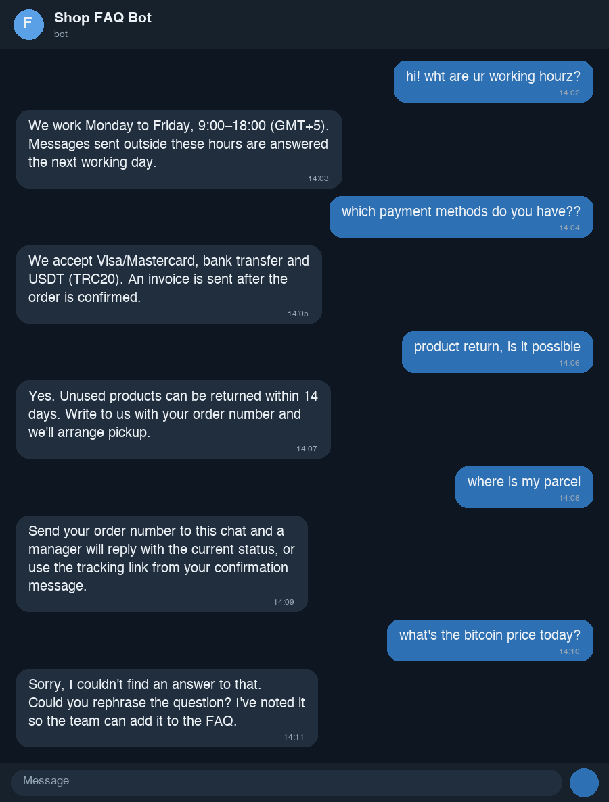

# Telegram FAQ Bot



A small, dependable Telegram bot that answers customer questions **only** from a
Q&A list you provide. No web search, no external AI, no invented answers.

- Fuzzy matching: tolerant to typos, word order, extra words and aliases.
- If nothing matches above the threshold, the bot apologises, asks to rephrase
  and logs the question to `data/unmatched.log` so you can extend the FAQ.
- Q&A lives in a plain **JSON or CSV** file. Edit it, send `/reload`, done.
- Works in private chats and in groups (in groups it replies only when
  mentioned or when someone replies to it, so it never spams).
- Admin commands: `/reload`, `/stats`, `/test <question>` (shows match scores).

## 1. Create the bot token

1. Open [@BotFather](https://t.me/BotFather) in Telegram, send `/newbot`, follow the prompts.
2. Copy the token (looks like `123456789:AAH...`).
3. Optional: `/setprivacy` → **Disable** if the bot must read group messages that do not mention it.

## 2. Install and run

```bash
git clone <this repo> faq-bot && cd faq-bot
python3 -m venv .venv && source .venv/bin/activate      # Windows: .venv\Scripts\activate
pip install -r requirements.txt
cp .env.example .env                                     # then edit .env
export $(grep -v '^#' .env | xargs)                      # Windows: set each variable manually
python -m faq_bot.bot
```

Environment variables (`.env.example`):

| Variable | Default | Meaning |
|---|---|---|
| `BOT_TOKEN` | — | token from BotFather (required) |
| `FAQ_PATH` | `data/faq.json` | Q&A file, `.json` or `.csv` |
| `MATCH_THRESHOLD` | `72` | 0–100, lower = more permissive |
| `ADMIN_IDS` | empty | comma-separated Telegram user IDs allowed to use admin commands |
| `FALLBACK_TEXT` | polite apology | reply when nothing matches |
| `UNMATCHED_LOG` | `data/unmatched.log` | where unanswered questions are stored |

Find your user ID with [@userinfobot](https://t.me/userinfobot).

## 3. Edit the knowledge base

**JSON** (`data/faq.json`):

```json
[
  {"question": "How can I pay?",
   "aliases": ["payment methods", "do you accept cards"],
   "answer": "We accept Visa/Mastercard, bank transfer and USDT."}
]
```

**CSV** (`question,answer,aliases`, aliases separated by `|`):

```csv
question,answer,aliases
How can I pay?,"We accept cards, bank transfer and USDT.",payment methods|do you accept cards
```

After editing, send `/reload` to the bot (as an admin) or restart it.
Use `/test some question` to see which entries score highest and tune aliases.

## 4. Try it without Telegram

```bash
python demo_cli.py data/faq.json
```

## 5. Run as a service (Linux, systemd)

```ini
[Unit]
Description=Telegram FAQ bot
After=network.target

[Service]
WorkingDirectory=/opt/faq-bot
EnvironmentFile=/opt/faq-bot/.env
ExecStart=/opt/faq-bot/.venv/bin/python -m faq_bot.bot
Restart=always

[Install]
WantedBy=multi-user.target
```

## Tests

```bash
python -m unittest -v
```

## Project layout

```
faq_bot/matcher.py   loading + fuzzy matching (rapidfuzz, stdlib fallback)
faq_bot/bot.py       Telegram handlers
faq_bot/config.py    environment settings
data/                faq.json, examples, unmatched.log
tests/               unit tests for the matcher
demo_cli.py          offline chat
```
